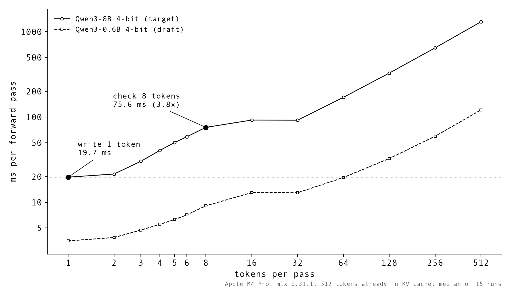

# specdec-from-scratch

speculative decoding from scratch on Apple MLX, plus every measurement and simulation behind my video [Speculative Decoding: How LLMs Break Their Own Speed Limit](https://www.youtube.com/@ThatNotesGuy).

in short: a small model guesses a few tokens ahead, the big model checks all of them in one forward pass, and one rule (`min(1, p/q)` plus the residual) keeps the output exactly the big model's. checking is cheaper than writing because one read of the weights can score many tokens at once.

everything here was measured on 2026-10-14:

- Apple M4 Pro (24 GB)
- `mlx` 0.31.1, `mlx_lm` 0.31.1
- target: `mlx-community/Qwen3-8B-4bit`, draft: `mlx-community/Qwen3-0.6B-4bit` (thinking mode off)
- greedy unless noted, up to 256 new tokens, median of 3 runs

## heads up before you run anything

these benchmarks froze my Mac once (too many model jobs back to back while memory was already tight). so:

- the numpy scripts in `task1_lossless/` are safe, they never load a model.
- for anything that loads a model: close heavy apps, run one script at a time, never two at once.
- the two models together take about 5.3 GB.

## setup

```bash
pip install -r requirements.txt
```

models download into `./hf_cache` on first run (about 5 GB). after that, `common.py` switches Hugging Face to offline mode.

## what's in here

| what | code | results |
|---|---|---|
| lossless proof, 2M trials per pair, + the E formula | `task1_lossless/spec_sampling.py` | `task1_lossless/results.txt` |
| three "obvious" acceptance rules that quietly change the model | `task1_lossless/wrong_rules.py` | `task1_lossless/wrong_rules_results.txt`, `wrong_rules.png` |
| verify cost vs tokens per pass (512 tokens in cache, median of 15) | `task2_roofline/verify_cost_curve.py` | `task2_roofline/verify_cost_curve.json`, `.png` |
| M4 Pro FLOPS + memory bandwidth, single-layer kernel scaling | `task2_roofline/measure_hw.py`, `kernel_scaling.py` | `task2_roofline/hw_results_ac.txt`, `kernel_scaling_results.txt` |
| `mlx_lm` draft-model sweep: 5 prompts × 2 to 8 guesses, temp 0 and 0.7 | `task3_mlx_lm/bench_mlx_lm.py` | `task3_mlx_lm/summary_temp0.md`, `summary_temp07.md` |
| bf16 near-tie divergence check | `task3_mlx_lm/divergence_check.py` | `logs/divergence.log` |
| from-scratch greedy + rejection-sampling loop (the code on the slide) | `task4_scratch/specdec_scratch.py` | `logs/task4_bench.log` |
| prompt lookup (n-gram) decoding, no draft model at all | `task5_prompt_lookup/prompt_lookup.py` | in `logs/task4_bench.log` |
| KV cache rollback check on a hybrid model (Qwen3.5) | `gotcha_hybrid_cache/hybrid_cache_check.py` | `logs/gotcha.log` |
| the on-camera demo | `task6_demo/demo.py`, `side_by_side.sh` | `logs/demo_*.log` |
| the charts from the video | `plots/*.py` | |

## the numbers

### the rule is exact (`task1_lossless`)

speculative sampling with `min(1, p/q)` plus resampling from `norm(max(0, p − q))`, 2,000,000 trials per (p, q) pair. TV = total-variation distance from the big model's distribution.

| rule | TV on the chart pair (V=6) |
|---|---|
| correct: `min(1, p/q)`, else residual | 0.0008 (chi² p = 0.41, indistinguishable) |
| accept if `p(x) ≥ q(x)` | 0.39 |
| accept with `min(1, p/q)`, else resample from `p` | 0.16 |
| keep only if it's the big model's top pick | 0.60 |

measured acceptance also matches theory, `α = Σ min(p, q)`. at temperature 0.7: code 0.819 measured vs 0.828 theory, creative 0.475 vs 0.474.

### my measurements (`task3_mlx_lm`, greedy)

| prompt | big model alone | best setting | acceptance α |
|---|---|---|---|
| fix typos in a paragraph | 49.7 tok/s | 88.1 tok/s (1.77×, 6 guesses) | 1.00 |
| write a Python function | 50.3 | 71.1 (1.41×, 2 guesses) | 0.87 |
| edit existing code | 53.2 | 73.3 (1.38×, 3 guesses) | 0.90 |
| step-by-step math | 52.8 | 68.9 (1.31×, 2 guesses) | 0.84 |
| short creative story | 49.6 | none helped. 8 guesses = 0.32× | 0.47 |

speculative decoding is a bet that the future is predictable. copying and code are. stories aren't.

### why my laptop gets 1.7× and NVIDIA gets 3.5× (`task2_roofline`)

one forward pass of the 8B model with 512 tokens already in the cache:

| tokens checked in one pass | time | vs writing 1 |
|---|---|---|
| 1 (normal decoding) | 19.7 ms | 1.0× |
| 2 | 21.5 ms | 1.09× (almost free) |
| 8 | 75.6 ms | 3.8× |
| 32 | 91.8 ms | (writing those 32 one at a time takes ~630 ms) |

the M4 Pro measured about 7.46 TFLOPS (bf16) and 243.6 GB/s, so its ridge point is around 31 FLOP/byte, about ten times lower than an H100's ~295. and 4-bit weights pack about 4× more math into every byte read. on my laptop the free zone is about 2 tokens. checking is still cheaper than writing, it just isn't free.



### lossless doesn't mean bit-identical

in my greedy runs the creative story split at token 17 ("for sailors" vs "to sailors") and the math answer around token 85. every split was a near-tie within half a logit in bf16 (a few were exact ties). checking several tokens in one pass rounds slightly differently, and that's enough to flip a tie. with float32 weights, every output matched exactly. same distribution, always. same text under greedy, up to rounding.

## two `mlx_lm` gotchas I found along the way

1. **rollback on hybrid models.** `trim_prompt_cache` silently does nothing for caches that can't be trimmed, and `speculative_generate_step` doesn't check for it. on hybrid linear-attention models (Qwen3.5), a rejected guess stays in the recurrent state. in `gotcha_hybrid_cache`, log-probs drifted by up to 9.7 nats from the first token, while the plain-decoding control stayed under 0.3.
2. **sampling acceptance.** at temperature > 0, `mlx_lm` keeps a draft token only if it equals an independent sample from the target. that's lossless, but it accepts less often than `min(1, p/q)`: 0.187 vs 0.640 on the chart pair (see the bonus rows in `task1_lossless/wrong_rules_results.txt`).

## papers

- Leviathan, Kalman, Matias (Google, 2022): [Fast Inference from Transformers via Speculative Decoding](https://arxiv.org/abs/2211.17192)
- Chen et al. (DeepMind, 2023): [Accelerating Large Language Model Decoding with Speculative Sampling](https://arxiv.org/abs/2302.01318)
- [EAGLE-3](https://arxiv.org/abs/2503.01840), [DFlash](https://arxiv.org/abs/2602.06036), [DSpark](https://arxiv.org/abs/2607.05147)

the code is short on purpose. it's for learning, not production. if you run it on your own hardware, I'd love to see your numbers :)

MIT license.
